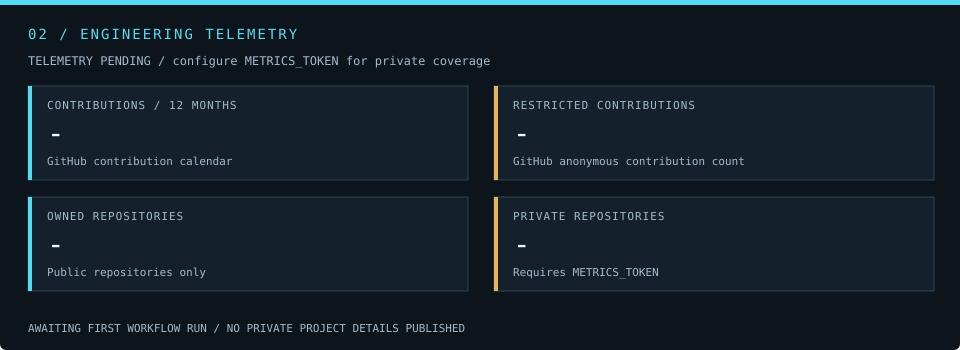

  

  
  

## 01 / Mission briefing

I'm Ben, the builder behind **RocketSloth Consulting**. I bring project management and engineering foundations to practical software, automation, and AI experiments.

I like systems that connect ideas to useful results: research tools, agent orchestration, websites, and hardware experiments. Slow and steady—then escape velocity.

| Engineering bay | Focus |
| :--- | :--- |
| **Autonomous systems** | AI workflows, agent coordination, and research tooling |
| **Digital infrastructure** | Websites, dashboards, and business automation |
| **Physical prototyping** | Electronics, connected devices, and 3D printing |

## 02 / Engineering telemetry

Most of my work lives in private repositories. These instruments focus on aggregate activity instead of public stars, trophies, or language rankings.

  

Private coverage depends on token permissions and GitHub contribution settings. [Telemetry definitions and setup](docs/telemetry.md).

## 03 / Tool lockers

| Systems & automation | Interfaces | Infrastructure |
| :--- | :--- | :--- |
| Python · Node.js | React · TypeScript | Git · GitHub Actions |
| JavaScript · AI workflows | HTML · CSS | Docker · Linux |

## 04 / Open a channel

Building a website, connecting a workflow, or turning an idea into a working prototype?

**[Visit RocketSloth Consulting →](https://rocketslothconsulting.com)** · **[Explore public repositories →](https://github.com/RocketSloth?tab=repositories)**

INDEPENDENT BUILDER / EARTH OPERATIONS · An original industrial space aesthetic inspired by engineering sandboxes.
